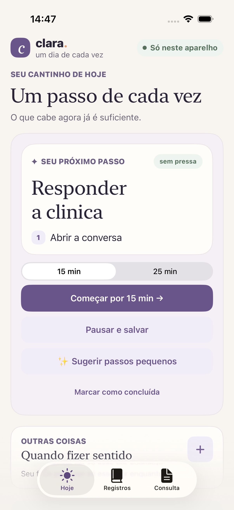
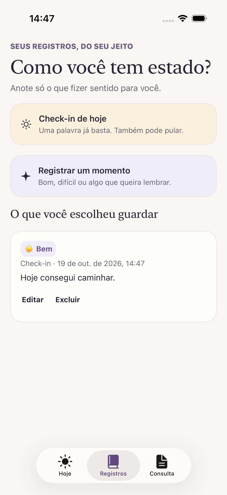
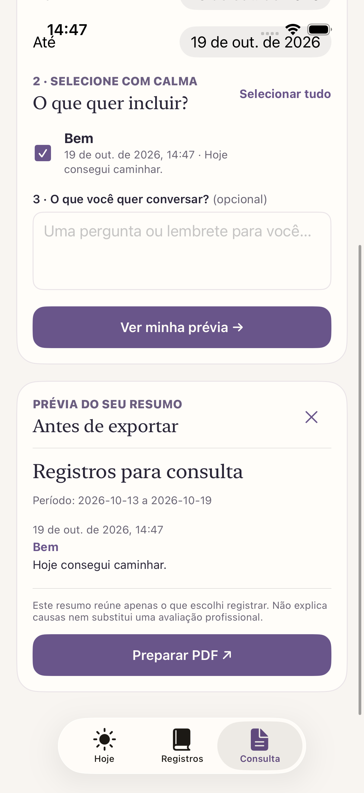

# Clara

A native iOS app for choosing a next step, parking distractions and preparing personal records for an appointment. Built with SwiftUI and MVVM, with local storage and optional on-device step suggestions.

The interface is in Brazilian Portuguese. Code and documentation are in English. iOS 17+.

## Context

Sometimes it is hard to pick where to start, stay on the important task or return to it after an interruption. It can also be hard to remember, at an appointment, which moments were good or difficult and what was happening. Clara helps start and resume one task at a time and keeps the user's own notes ready to bring to an appointment, with or without an ADHD diagnosis. It does not diagnose, score symptoms or interpret mood, and the user's data is never sent to a server; it only leaves the device when the user shares an exported PDF.

<p>
  
  
  
</p>

## Try the main flow

1. In **Hoje**, add a task and its first step. Choose 15 or 25 minutes, start focusing, then pause and leave a clue for resuming. Park unrelated ideas in “Isso pode esperar”.
2. In **Registros**, save a daily check-in or a moment. A word or a short note is enough. Edit or delete it from the timeline.
3. In **Consulta**, choose a period, select the records to include, add questions and preview the summary before sharing an A4 PDF.

“Passos pequenos” suggests ways to start the focused task. Apple Intelligence runs on the device when available; other devices receive simple suggestions. The screen identifies the source.

## Run on a Mac

Requires Xcode 26+ and an iOS simulator or device.

```bash
brew install xcodegen swiftlint
xcodegen generate
open Clara.xcodeproj
```

Select an iPhone simulator and run with ⌘R. Run tests with ⌘U.

```bash
xcodebuild test -project Clara.xcodeproj -scheme Clara \
  -destination 'platform=iOS Simulator,name=iPhone 17' -skipMacroValidation
```

On-device generative suggestions require iOS 26 and a device with Apple Intelligence enabled. The app remains usable without them and without an internet connection. The holiday notice is the only network feature and requests only the year from BrasilAPI.

## Design decisions

- **SwiftUI + MVVM throughout.** Views own sheets, dialogs and form drafts. View models handle loading, validation and saving. The three tabs share a small set of visual components.
- **Three modules.** `ClaraCore` contains models and report rules; `ClaraInfrastructure` implements storage, networking and on-device suggestions; `ClaraUI` contains screens and view models. The app assembles their dependencies.
- **Local persistence.** An actor serializes access to a JSON file. Writes are atomic and protected by iOS file protection; memory updates only after a successful write. Revisions prevent stale record edits from overwriting newer data.
- **Faithful reports.** Selection respects the local day of each record, including its original time zone. Export preserves the user's words and escapes text before rendering HTML as PDF.
- **Privacy.** Task and record content is never sent to a server. Optional local usage events contain only action metadata. The user chooses whether and with whom to share an exported PDF. The app makes no clinical interpretations.

## Limitations and next steps

- **Storage.** JSON storage fits a small personal app. Large histories and schema migrations would need further work.
- **Timer.** It counts while the app is active; background countdown recovery is not implemented.
- **Branch.** This branch (`entrega`) is the delivered version. The same work is also split into stacked pull requests into `main`, which are still in CI.
- **CI time.** The CodeQL Swift build spends ~8 of its ~12 minutes evaluating `Package.swift` under the tracer. A fix that skips the manifest was measured on a local Mac (156 s → 17 s, same 33 source files extracted) and is being validated in CI.
- **UI tests.** XCUITest runs on every pull request. Moving it to the weekly run would need more unit tests in `ClaraUI`, because total coverage drops to 40% (below the 50% gate) without it.

## Repository

```text
App/                              App entry point and dependency assembly
Packages/ClaraKit/
  Sources/ClaraCore/               Models and report rules
  Sources/ClaraInfrastructure/     Storage, networking, local events, AI
  Sources/ClaraUI/                 Today, Records, Consultation, shared components
  Sources/ClaraTestSupport/        Shared test doubles and fixtures
  Tests/                          Behavior tests and visual snapshots
AppUITests/                       Accessibility audits and UI behavior
.maestro/                         End-to-end journeys
```

Tests cover persistence, revision conflicts, report filtering, HTML escaping, PDF output, suggestions fallback and screen behavior. Snapshots cover light/dark appearance and large text. XCUITest audits accessibility; Maestro exercises the main journeys.

The existing CI and AI-assisted development checks are documented in [Guardrails](docs/GUARDRAILS.md). Architecture details: [module boundaries](docs/adr/0001-modularization-spm-xcodegen.md), [SwiftUI and MVVM](docs/adr/0002-architecture-per-feature.md), [on-device suggestions](docs/adr/0003-on-device-ai.md).

This is the native Swift version of the product originally explored in React Native (`daily-focus`). It was developed with AI assistance; implementation choices and verification are recorded in the repository.
